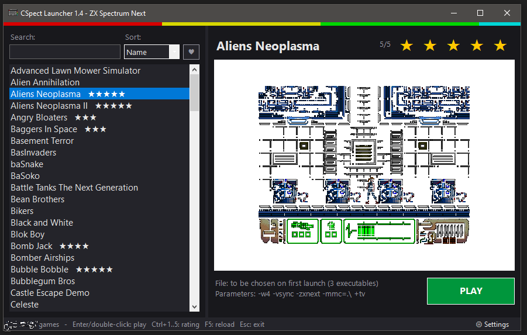

# CSpect Launcher

A game launcher for the ZX Spectrum Next emulator **CSpect**.
Version 1.3 · © 2026 Giuseppe Papa · [GPL-3.0](LICENSE)



CSpect Launcher is a simple Windows, Linux and macOS front-end that lists the ZX Spectrum Next games in a folder and starts them in the CSpect emulator with one click. You can rate games, add cover pictures, hide games you do not want to see, set custom launch parameters per game and much more.

The interface is available in **English, Italian, Spanish, French and German**.

> 🐧🍎 **Linux and macOS version:** a version with the same features for Linux and macOS (macOS support is experimental) is available in the [`linux`](linux/) folder and as the `CSpectLauncher-Linux-macOS` package in the [Releases](https://github.com/Saxabar/CSpectLauncher/releases) — see the [Linux / macOS README](linux/README.md). All versions use the same `games.ini` file.

## Features

- Game list with search and sorting by name or rating
- 1–5 star ratings
- Cover pictures, taken automatically from CSpect screenshots (F5)
- Executables found in the game folder and its subfolders (`.nex`, `.snx`, `.sna`)
- NextBASIC (`.bas`) and tape (`.tap`) games started automatically through NextZXOS
- Per-game launch parameters, custom titles and hidden games
- Delete a game's save files (moved to the Recycle Bin)
- Settings for language, folders, window size (1x–4x) and full screen
- Everything stored in a plain `games.ini` file
- Versions for Windows, Linux and macOS (experimental)

## Requirements

The instructions below are for the **Windows** version. For Linux and macOS see the [Linux / macOS README](linux/README.md).

- Windows with Windows PowerShell (already included in Windows 10 and 11)
- The CSpect emulator by Mike Dailly: <https://mdf200.itch.io/cspect>
  CSpect itself needs the latest .NET and OpenAL on Windows (see the CSpect ReadMe).

## Installation

Download `Launcher.bat` and `Launcher.ps1` and copy them into a folder of your choice. A typical layout is:

```
My Next Games\
    Launcher.bat        <- double-click this to start the launcher
    Launcher.ps1        <- the launcher program
    games.ini           (created automatically on first run)
    CSpect\             (the CSpect emulator, with CSpect.exe)
    GAMES\
        Bubble Bobble\
            p_BUBNEXT.nex
        Night Knight\
            Night Knight.nex
        ...
```

Every game must be in its own subfolder inside the games folder. The CSpect and games folders can also be anywhere else on your disk: you choose them in the settings.

## First run

Double-click `Launcher.bat`. If `games.ini` does not exist yet, a welcome window asks for:

- **Language**
- **Games folder**: the folder that contains one subfolder per game
- **CSpect folder**: the folder that contains `CSpect.exe`

Use the `...` buttons to browse. If you do not have CSpect yet, click the **Download CSpect** link. Press OK and `games.ini` is created.
Folders inside the launcher folder are saved as relative paths (`.\GAMES`), so you can move the whole folder elsewhere without changing anything.

## How to use

### Main window

- **Left:** the game list, with a Search box and a Sort menu (Name / Rating).
- **Right:** title, rating stars, cover picture, file name, parameters and the **PLAY** button.
- Drag the thin divider between list and details to resize the list (the width is remembered).

### Starting a game

Double-click the game, press **Enter**, or click **PLAY**.
CSpect starts in the folder of the game's executable, so save files and screenshots are stored next to the game.

Supported files are `.nex`, `.snx` and `.sna`, also inside subfolders. Games that only contain NextBASIC (`.bas`) or tape (`.tap`) files are started through NextZXOS (see below). Games with none of these files are marked *(not launchable)*.

If a folder contains more than one executable, the launcher asks which one to use the first time and remembers the choice.

### .bas and .tap games (NextZXOS)

CSpect cannot open `.bas` and `.tap` files directly: they need NextZXOS, the operating system of the Next. When you start one of these games, the launcher:

1. copies the NextZXOS system files once from your SD card image (by default `zxnext.sd` in the CSpect folder, the image downloaded by CSpect's `ZXOS.bat`);
2. creates a small SD card image (64 MB or more) in your temporary folder, with NextZXOS, the game's folder and an `autoexec.bas` that loads the game;
3. starts CSpect with that image: NextZXOS boots and the game starts by itself.

The image is created with **hdfmonkey**, which is included with CSpect (`hdfmonkey` folder). Your `zxnext.sd` is only read, never changed.

CSpect does not include `zxnext.sd`: it is downloaded the first time you run CSpect's `ZXOS.bat`. If it is missing, the launcher offers to:

- **Yes:** run `ZXOS.bat` now. CSpect opens in full screen and asks *"ZX Spectrum next SD Image not found, do you wish to download it?"*: answer **Yes** (if the question is hidden behind the full screen, press **Alt+Tab**). CSpect then downloads the image (the screen stays black meanwhile), while the launcher shows a waiting window with the elapsed time. When the NextZXOS menu appears, close CSpect with **Alt+F4**: the game then starts by itself;
- **No:** select an SD card image you already have (saved as `nextzxos=` in `games.ini`);
- **Cancel:** do nothing.

Notes:

- `.tap` files are loaded in 128K mode; a few games that need 48K mode may not work.
- The image is created again at every launch, so anything the game saves (high scores, saved games) is lost when CSpect is closed. Images of previous launches are deleted automatically (except the one of a CSpect still running).
- CSpect starts in the game's folder, so F5 screenshots are saved next to the game and used as the cover, as for the other games.
- The file shown in the details ends with *(with NextZXOS)*. The CSpect option `-mmc=` is not used for these games.

### Rating

Click the stars next to the title (click the same star again to remove the rating), or press **Ctrl+1 … Ctrl+5** (**Ctrl+0** removes it).

### Cover pictures

While playing, press **F5** in CSpect to take a screenshot: it is saved in the game folder and used automatically as the cover. When you return to the launcher, the picture is updated.

Picture priority:

1. `image=` in `games.ini`
2. the latest CSpect screenshot of the executable (`<name>_<date>.png`, or `screenshot_<date>.png` for `.bas` / `.tap` games)
3. `cover.*` / `copertina.*`
4. the latest other CSpect screenshot in the folder
5. `screen*` / `title*`
6. the first picture found in the folder

If you take several screenshots, the most recent one is used.

### Right-click menu (on a game)

| Item | What it does |
|---|---|
| Choose executable... | pick which `.nex` / `.snx` / `.sna` (or `.bas` / `.tap`) file to start |
| Launch parameters... | custom CSpect parameters for this game only (empty = general ones) |
| Rename title... | change the name shown in the list (empty = folder name) |
| Hide game / Show game again | hide or show the game in the list |
| Delete save files (.sav)... | moves the game's `.sav` files to the Recycle Bin, after confirmation |
| Show hidden games | temporarily shows hidden games, so you can show them again |

### Settings (gear button, bottom right)

- Language
- Games folder and CSpect folder
- Window size (1x to 4x, CSpect option `-w1` … `-w4`)
- Full screen (CSpect option `-fullscreen`)
- Other CSpect parameters (default: `-vsync -zxnext -mmc=.\`)
- Credits, version, license and links to this page and to CSpect

### Keyboard shortcuts

| Key | Action |
|---|---|
| Enter | start the selected game |
| Up / Down | move in the list (also while typing in Search) |
| Ctrl+1 … Ctrl+5 | set the rating |
| Ctrl+0 | remove the rating |
| F5 | reload the game list |
| Esc | clear the search, or close the launcher |

## games.ini reference

`games.ini` is a plain text file; you can edit it with Notepad (close the launcher first). Everything can also be changed from the launcher itself.

```ini
; general settings
[_default]
lang=en
games=.\GAMES
cspect=.\CSpect
args=-w2 -vsync -zxnext -mmc=.\
sort=name
listwidth=368
nextzxos=.\CSpect\zxnext.sd

; one section per game folder (all keys are optional)
[Folder name]
file=game.nex
rating=4
title=My title
args=-w3 -zxnext -mmc=.\
image=cover.png
hidden=1
```

| Key | Meaning |
|---|---|
| `lang` | language: `en`, `it`, `es`, `fr`, `de` |
| `games` | games folder (absolute or relative to the launcher) |
| `cspect` | CSpect folder or path of `CSpect.exe` |
| `args` | in `[_default]`: CSpect parameters for all games; in a game section: custom parameters for that game |
| `sort` | list order: `name` or `rating` |
| `listwidth` | list width in pixels |
| `nextzxos` | SD card image with NextZXOS, used for `.bas` / `.tap` games (empty = `zxnext.sd` in the CSpect folder) |
| `file` | executable to start (may include a subfolder) |
| `rating` | rating 1..5 |
| `title` | name shown in the list |
| `image` | picture to show |
| `hidden` | `1` = hide the game |

Comments must be on their own line, starting with `;`.

New game folders are added automatically. When a game folder no longer exists, its section is removed; the previous file is kept as `games.ini.bak`.

## License

CSpect Launcher is free software, released under the **GNU General Public License version 3** (GPL-3.0). You may use, copy, modify and redistribute it under the terms of that license; modified versions must be released under the same license, with their source code. It comes **without any warranty**. See [LICENSE](LICENSE) or <https://www.gnu.org/licenses/gpl-3.0.html>.

CSpect and the games are **not** part of this project and are not covered by this license: they belong to their respective authors.

## Credits

- **CSpect Launcher**: © 2026 Giuseppe Papa, GPL-3.0
- **CSpect emulator**: by Mike Dailly, <https://mdf200.itch.io/cspect>
- ZX Spectrum Next games belong to their respective authors.
