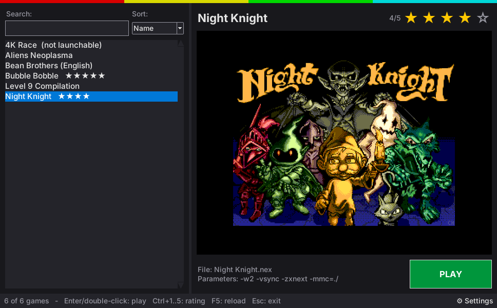

# CSpect Launcher for Linux and macOS

The Linux and macOS version of **CSpect Launcher**, the game launcher for the ZX Spectrum Next emulator CSpect. For macOS see the [macOS section](#macos) below.
Version 1.5 · © 2026 Giuseppe Papa · [GPL-3.0](../LICENSE)



It has the same features as the Windows version (game list with search and sorting, ratings, cover pictures from CSpect screenshots, per-game executable, parameters, titles and hidden games, save file deletion, settings, five languages) and uses the **same `games.ini` file**, so ratings and choices are shared if you use both systems on the same folder.

For the full user guide (features, right-click menu, keyboard shortcuts, `games.ini` reference) see the [main README](../README.md).

## Requirements

- **Python 3** with **Tkinter**
- **Mono**, needed by CSpect on Linux
- *Optional:* **Pillow**, for `.jpg` / `.bmp` covers and smoother picture scaling (without it, `.png` and `.gif` covers still work)
- The **CSpect** emulator by Mike Dailly: <https://mdf200.itch.io/cspect>

On Ubuntu / Debian / Linux Mint:

```sh
sudo apt install python3 python3-tk mono-devel python3-pil python3-pil.imagetk
```

On Fedora:

```sh
sudo dnf install python3 python3-tkinter mono-devel python3-pillow python3-pillow-tk
```

On Arch Linux:

```sh
sudo pacman -S python tk mono python-pillow
```

Package names may differ slightly between distribution versions.

## Installation

Download `CSpectLauncher-Linux-macOS-<version>.tar.gz` from the [Releases](https://github.com/Saxabar/CSpectLauncher/releases) and extract it (`tar -xzf CSpectLauncher-Linux-macOS-<version>.tar.gz`), or copy `launcher.py` and `cspect-launcher.sh` into a folder of your choice. If the scripts are not executable, run:

```sh
chmod +x cspect-launcher.sh launcher.py
```

A typical layout is:

```
CSpectLauncher/
    cspect-launcher.sh     <- run this to start the launcher
    launcher.py            <- the launcher program
    games.ini              (created automatically on first run)
    CSpect/                (the CSpect emulator, with CSpect.exe)
    GAMES/
        Bubble Bobble/
            p_BUBNEXT.nex
        Night Knight/
            Night Knight.nex
        ...
```

## Starting

```sh
./cspect-launcher.sh
```

or `python3 launcher.py`. You can also double-click `cspect-launcher.sh` in your file manager, if it is set to run executable scripts.

On the first run a window asks for the language, the games folder and the CSpect folder, then creates `games.ini`.

### Menu shortcut (optional)

To add the launcher to your applications menu, create the file `~/.local/share/applications/cspect-launcher.desktop` with this content (replace the path with your own folder):

```ini
[Desktop Entry]
Type=Application
Name=CSpect Launcher
Comment=Game launcher for the ZX Spectrum Next emulator CSpect
Exec=/home/YOUR_NAME/CSpectLauncher/cspect-launcher.sh
Path=/home/YOUR_NAME/CSpectLauncher
Terminal=false
Categories=Game;Emulator;
```

## Differences from the Windows version

- CSpect is started with `mono CSpect.exe ...`, from the folder of the game's executable (as in the `.sh` examples that come with CSpect).
- Paths written by the Windows version (`.\GAMES`, `-mmc=.\`, `folder\game.nex`) are converted automatically, so the same `games.ini` works on both systems.
- "Delete save files (.sav)" moves the files to the desktop **Trash**.
- "Open game folder" opens the game folder in your file manager (with `xdg-open`).
- File names on Linux are case sensitive; the launcher still recognises extensions such as `.NEX` or `.SAV` in upper case.
- `.bas` and `.tap` games (started through NextZXOS, see the main README) use the Linux build of hdfmonkey included with CSpect (`hdfmonkey/linux-musl/hdfmonkey`, made executable automatically if needed). The NextZXOS files and the temporary SD card images are kept in `~/.cache/cspect-launcher`. The SD card image is the `zxnext.sd` downloaded by CSpect's `ZXOS.sh`; if it is missing, the launcher offers to run `ZXOS.sh` (with `bash`) to download it.
- The **CSpect 3 compatibility** fixes (right-click menu) are passed to CSpect in the `CSPECT_COMPAT` variable, as on Windows. They need the [CSpect Compat](https://github.com/Saxabar/CSpectCompat) plugin next to `CSpect.exe`; it is a plain .NET plugin, but it has not been tested with mono yet.

## macOS

The same `launcher.py` also runs on macOS. This is **experimental**: it has not been tested on a Mac yet, so please report any problem.

### Requirements

- **Python 3** with **Tkinter**: the installer from <https://www.python.org/downloads/macos/> includes it. With Homebrew: `brew install python python-tk`.
- **Mono**, needed by CSpect on macOS: <https://www.mono-project.com/download/stable/> (CSpect's ReadMe asks for the latest version). Whether Mono and CSpect run well on Macs with Apple chips (M1–M4) has not been checked.
- *Optional:* **Pillow** (`pip3 install pillow`), for `.jpg` / `.bmp` covers and smoother picture scaling.
- The **CSpect** emulator by Mike Dailly: <https://mdf200.itch.io/cspect>

### Starting

Double-click **`cspect-launcher.command`** in the Finder (or run `./cspect-launcher.command` in Terminal). If the files lost their execute permission, run once in Terminal, in the launcher folder:

```sh
chmod +x cspect-launcher.command launcher.py
```

The first time, macOS may block the script or CSpect's `hdfmonkey` because they are not signed by an identified developer. In that case right-click the file and choose **Open**, or allow it in **System Settings → Privacy & Security**. The launcher never changes these security settings by itself.

### Differences on macOS

- Mono is also looked for in `/Library/Frameworks/Mono.framework`, `/opt/homebrew/bin` and `/usr/local/bin`, because programs started from the Finder do not always see the Terminal `PATH`.
- "Delete save files (.sav)" moves the files to the macOS **Trash**; "Open game folder" opens it in the Finder with the executable selected.
- Right-click (or Control-click) opens the game menu; **Cmd+1 … Cmd+5** also set the rating.
- `.bas` and `.tap` games use the macOS build of hdfmonkey included with CSpect (`macos-mn` on Apple chips, `macos-intel` on Intel Macs). The NextZXOS files and the temporary SD card images are kept in `~/.cache/cspect-launcher`.
- CSpect's changelog says that downloading the NextZXOS SD card image with `ZXOS.sh` on Mac and Linux can be very slow.

## License

Free software released under the GNU General Public License version 3 (GPL-3.0), without any warranty. CSpect and the games are not part of this project and belong to their respective authors.
